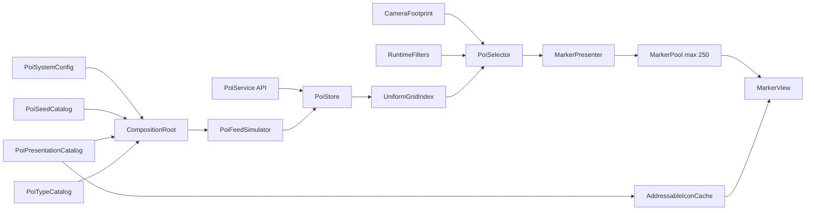

# POI System Prototype

The brief asks for Unity **2022.3.62f2**. That editor is not installed. Hub has **2022.3.62f3** and Unity 6. You approved building on **2022.3.62f3** and documenting the patch mismatch in the README. Do not switch to Unity 6.

Optional items (edge indicators, declutter, click details, mock network, Jobs/Burst, bonus video) stay out. Nothing in this plan is implemented yet. A feature is not complete until its implementation and its automated test or its real measurement have passed. Estimates are not measurements.

## ScriptableObject architecture

Authored content and tuning live on assets. The scene composition root only holds references to those assets and builds the runtime objects from them. Swapping a catalog, a prefab, or a sprite does not require a code change.

- `Assets/Poi/Config/PoiSystemConfig.asset` — world size, cell size, LOD ranges, marker budget, camera height limits, FOV, simulator defaults. This is the single tuning surface.
- `Assets/Poi/Config/PoiSeedCatalog.asset` — initial POIs as serialized entries: id, name, `PoiType`, position, `IconKey`, `PoiPriority`. This is the required ScriptableObject dataset. A small JSON file can still be imported into this asset by an editor menu, but play mode reads the catalog, not a 250,000-row file. The simulator appends generated POIs in the same record shape until the live count is reached.
- `Assets/Poi/Config/PoiPresentationCatalog.asset` — replaceable presentation. Each entry is an `IconKey` plus an Addressables sprite reference. It also points at the marker prefab Addressable, the world-space label font, and the ground material. Code looks up icons by key from this catalog and never embeds a sprite, color, or path.
- `Assets/Poi/Config/PoiTypeCatalog.asset` — one row per `PoiType` enum value: display name and default icon key. The HUD builds its toggles from the enum, and the catalog only supplies labels and art.

At play start the seed catalog is copied once into the store. After that, the live dataset is the store, not the asset. `PoiSystemConfig` is not cloned. The camera, selector, and simulator read that asset every frame, so Inspector edits during Play apply on the next frame. The HUD writes the same fields, so the Game view and the Inspector stay on one set of values. Play Mode edits to a ScriptableObject are saved with the asset. The README will say that.

## Enums

Hot data stores the enum’s underlying byte. There are no string types or magic priority numbers on the lookup path.

- `PoiType`: Landmark, Resource, Hazard, Settlement, Objective. Filters and the type catalog use this enum.
- `PoiPriority`: Low, Normal, High, Critical, with explicit values 0–3 that match the grid buckets. Selection sorts by this value, then distance. The HUD and the config Inspector expose it as an enum popup, not an int field.
- `MarkerLod`: None, Icon, IconAndLabel. The selector returns this. None means no pooled marker.
- `IconKey`: one value per placeholder sprite. The presentation catalog is a serialized array indexed by this enum, so a missing sprite is a missing asset reference, not a mistyped string.
- `PoiChangeKind`: Name, Type, Priority, Icon. The Changed event carries this so a priority or type change rebuckets, and a name or icon change only refreshes a bound marker.

JSON import maps strings onto these enums and rejects unknown names. Tests construct records with the enums directly.

## Editor live editing

Runtime changes are possible from the Game view and from the Unity Inspector. An editor assembly, `Assets/Poi/Editor/Poi.Editor.asmdef`, holds the tooling.

- `PoiSystemConfigEditor` draws ranges, budget, camera height, and simulator rates with sliders, and draws type, priority, and icon fields as enum popups. `OnValidate` bumps a version integer. The play-mode loop already reads the asset, so a change applies without entering Play again and without a scene reload.
- `PoiDemoControllerEditor` shows the same controls on the scene object, plus Add, Move, and Remove for one POI. Those buttons call `PoiService` and are disabled outside Play.
- Seed rows use a property drawer so type, priority, and icon key are enum dropdowns.
- The Addressables setup menu and the JSON-to-catalog importer live in this editor assembly.

Changing world size or cell size during Play is refused. Those values define the grid, and rebuilding them in the middle of a 250,000 POI session would violate the incremental-update rule. The inspector disables them in Play Mode. Budget, ranges, filters, camera height, and simulator rates stay editable.

ScriptableObjects are the content and composition layer. They are not the per-frame bus. Routing hundreds of thousands of add/move/remove events through UnityEvents would allocate and would hide the lookup from edit-mode tests. `IPoiFeed` stays a plain C# interface with Added, Moved, Changed, and Removed events. Tests construct the store, grid, and selector with no assets. The demo scene is the only place that binds assets to that core.

## Placeholder art that can be replaced

All shipped visuals are obvious placeholders, and every one is assigned on the presentation catalog or on the marker prefab:

- Five solid-color icon sprites, one per type, generated into `Assets/Poi/Art/Placeholder/` and registered on `PoiPresentationCatalog`.
- A marker prefab: a quad for the icon and a world-space text label. The prefab’s sprite and font slots start empty at runtime and are filled from the catalog. No script contains a default sprite.
- A checker ground material and a simple capsule player mesh, both referenced by the catalog or by serialized scene slots, not by `Resources.Load` strings buried in code.

Replacement path, documented in the README: drop in new sprites, assign them to the same icon keys on `PoiPresentationCatalog`, or replace the marker prefab reference. Addressable addresses stay on the catalog entries, so the loader code does not change. Missing keys show a catalog-assigned fallback placeholder sprite instead of a null marker.

## Architecture

Data never becomes a GameObject. Only the markers that won the budget exist in the scene, and that count is capped at 250.

Dependencies are constructor-injected from one composition root. The lookup types take a ground rectangle, player position, ranges, filters, and budget. They do not reference `Camera`, scenes, or `MonoBehaviour`, so edit-mode tests can run them with plain data.

**Pitch is 90 degrees** (straight down). Ground distance from the player decides LOD, because every on-screen POI is about the same distance from the camera. Default ranges, all configurable on `PoiSystemConfig`:

- Close: 150 m, icon plus label
- Mid / display: 500 m, icon only
- Beyond 500 m, or outside the camera ground rectangle: no marker

At height 400 m and a 60 degree vertical FOV, the ground footprint is about 820 m by 460 m. A 500 m display range covers that footprint except the far corners, so raising the camera actually adds candidates, and the close band stays a disc around the player.

## Hot data and the grid

`PoiStore` keeps one `PoiSlot[]` plus a free list. A slot holds id, type, priority, icon key id, XZ position, and intrusive list indices. Names live in a side array and are dropped when the slot is freed. No class is allocated per POI.

`UniformGridIndex` covers the 16 km world with a **400 m** cell (40 by 40 cells). Each cell has one doubly linked list per `PoiPriority` bucket (0–3). Add, remove, move, and priority change relink only that slot: **O(1)**, no grid rebuild. A move that stays inside the same cell only updates the stored position.

The simulator does not scan all POIs to decide who moves. It keeps an explicit mover array. Membership is updated when a POI is added or removed, or when the move-percent setting changes. Each frame only that array is integrated. At 5 percent of 250,000, that is 12,500 O(1) relinks, not an O(N) rebuild.

## Selection, budget, and filters

Selection is priority first, then nearest inside that priority. A closer lower-priority POI never replaces a farther higher-priority POI. Distance is ground distance from the player, `(dx, dz)` on the XZ plane. Distance to the camera, including camera height, is not used.

`PoiSelector` does this every frame:

1. Visit only grid cells that overlap the camera ground footprint. POIs outside those cells are not read.
2. Walk `PoiPriority` from Critical down to Low, skipping priorities the filter excludes.
3. For the current priority, examine every POI in those cells that also passes the type filter, the display range, and the footprint rectangle. This step is not capped at the marker budget. If 2,000 Critical POIs lie in the footprint, all 2,000 are examined even when the budget is 250.
4. If that band has fewer POIs than the remaining budget, accept all of them and continue to the next lower priority.
5. If that band has more than the remaining budget, keep the nearest `remaining` by ground distance and stop. Lower priorities are not examined. The nearest-K step uses a size-K heap or an in-place quickselect over the whole band, not a scan that stops after K hits.
6. Write survivors into a reused result buffer with their `MarkerLod`. No LINQ, no `FindObjectsOfType`, no physics queries.

**Complexity that will be stated and measured.** Let `C` be the number of cells overlapping the footprint. `C` depends on camera height, FOV, aspect, and cell size. Let `B_p` be the number of priority-`p` POIs inside those cells that pass the range and filters. Let `p*` be the lowest priority actually examined: every higher band was smaller than the remaining budget, and `p*` fills it, or the budget never fills. POIs examined = the sum of `B_p` for every `p` from Critical through `p*`. Nearest-K inside the filling band costs `O(B_p* log K)` with a bounded heap. That sum is not `O(K)`. It grows when density inside the footprint grows. The scaling claim is narrower and is the one the measurements must support: POIs outside the footprint are not examined, so adding POIs outside the camera does not increase lookup cost. The equal-priority worst case examines every qualifying POI in the footprint, which can approach `N` if the whole dataset sits inside the view.

The band buffer is reused. Growing it allocates. A camera-height change or a jump to 250,000 POIs may allocate on that frame. Steady-state frames after the high-water mark may not. Both are measured. The plan does not promise that examination stays near 250, and it does not promise zero allocations.

Filters (type mask and minimum priority) are applied while the band is scanned, so they change the result on the same frame. `PoiService` is the public API: `Add`, `Move`, `Change`, `Remove`, plus filter, budget, and simulator settings. Large count changes (1,000 to 250,000 and back) are applied in batches of a few thousand per frame so the scene is not reloaded. Removed slots return to the free list immediately.

## Markers and Addressables

`MarkerPool` prewarms `budget` instances after one async Addressables load of the marker prefab. The presenter diffs the selected set against the active set every frame: release losers, bind winners, move survivors. The budget is reapplied while the player moves and the feed churns, not only after a refresh.

Each `MarkerView` has a bind generation. `Bind` increments it and clears the sprite and label before requesting an icon. `Release` increments it again. A late Addressables callback applies the sprite only when the generation still matches. Loaded sprites are cached by `IconKey`, so steady state does not reload the same icon every frame.

Add `com.unity.addressables`. An editor setup script marks the placeholder marker prefab and the catalog sprites as addressable, using the addresses stored on `PoiPresentationCatalog`, so the project is reproducible without hand-clicking the Addressables window. Replacing art means replacing those catalog entries and rerunning the setup, or assigning new addressable sprites to the same keys.

## World, camera, and controls

- One 16 km ground quad and a kinematic player clamped to the world. WASD movement.
- Camera sits at the player XZ, pitch 90, height driven from 50 m to 400 m. Perspective, 60 degree FOV.
- The ground footprint is the intersection of the camera frustum with the plane `y = 0`, using that camera’s pitch, FOV, aspect, and height. `GroundFootprint` is the only function the selector trusts for the rectangle. An edit-mode test creates a real `Camera` and checks the four corners against `ViewportToWorldPoint` on that plane. The selector tests themselves still pass a rectangle in and do not reference `Camera`. A separate test places two same-priority POIs at ground distances 40 m and 180 m under a 400 m camera and asserts the 40 m POI ranks nearer. Their 3D distances to the camera are both about 400 m, so a camera-distance sort would not produce that order.
- uGUI panel, not IMGUI: POI count (1,000 to 250,000, up and down), type toggles, minimum priority, camera height (50 m to 400 m), initial-count apply, additions per second, removals per second, moving percent, and movement speed. Three buttons call the public `Add`, `Move`, and `Remove` API on one POI so that path is visible in the demo, not only in code. Stats text refreshes a few times a second so the hot path does not allocate strings.
- Demo scene: `Assets/Scenes/PoiDemo.unity`, set as the build scene. The camera follow, height, and pitch live here.

`PoiSeedCatalog` holds the sample dataset. The simulator generates further POIs in the same shape up to the live count. A 250,000-row asset is not the dataset; the slider grows the live store in batches. An optional editor importer can fill the catalog from JSON, which keeps the brief’s JSON path without making JSON the runtime source.

## Assemblies and tests

- `Assets/Poi/Runtime/Poi.Runtime.asmdef` — gameplay and pure logic
- `Assets/Poi/Editor/Poi.Editor.asmdef` — inspectors, property drawers, Addressables setup, JSON import
- `Assets/Poi/Tests/Editor/Poi.Tests.asmdef` — edit-mode tests, no scene

Lookup tests pass a rectangle and a player position in. They do not create a scene. The footprint test is the exception: it creates a `Camera` only to compare the projection helper with Unity’s own viewport projection.

- Insert, remove, and cross-cell move stay consistent with the store
- POIs outside the rect or display range are excluded
- Priority-first top-K: a nearer Low POI loses to a farther Critical POI. Inside one priority, the kept set is the nearest K
- Equal priority: more than K POIs share one priority inside the footprint. The result is the K nearest, and the examined count equals the whole band, not K
- Camera height: the same dataset at 50 m and at 400 m changes the footprint and the selected set, and the active count never exceeds the budget
- Player movement: shifting the player brings a POI into the rect and drops another. Selection follows the player, using ground distance
- Footprint matches the camera: four ground-plane corners agree with `ViewportToWorldPoint` within a tight epsilon
- Filters: changing the type mask or minimum priority changes the result on the next query, and the budget is filled from the filtered set only
- Rapid add, move, and remove in one update: the index matches the store, removed ids are absent, and freed slots can be reused
- Budget under continuous updates: interleaved moves and feed events never leave the selected count above the budget, and higher priorities are kept
- Stale async icon: a fake load completes after `Release`, after `Bind` to a different POI, and after the POI is removed. Sprite and name stay cleared or match only the current bind
- Scaling: a small footprint over 250,000 POIs examines only the POIs in the overlapped cells through `p*`. The examined count is reported in the test output. The test fails if the selector walks the whole store. It does not assert that the count is near 250

## Measurements, docs, and git

Lookup, movement simulation, and incremental grid updates are timed separately. A slow simulator must not be reported as lookup cost, and grid relinks must not be folded into the selector time.

The harness runs while the player is moving, the feed is churning, and the camera is at 400 m. Moving percent is 5, so the mover count is 5 percent of the live set. The 250,000 row is the required stress case: **12,500 moving POIs per frame**. The 1,000 and 25,000 rows use the same 5 percent so the three rows are comparable. Each row records:

- average frame time and 95th percentile over a fixed sample window after warm-up
- lookup milliseconds (`PoiSelector` only)
- movement-simulation milliseconds (integrating the mover list)
- grid-update milliseconds (incremental relinks for those movers)
- POI-system GC bytes per frame: lookup, simulation, grid update, and marker sync
- total frame GC bytes per frame, which includes the HUD
- active marker count
- POIs examined by the selector, so the complexity claim can be checked against `B_p`
- hardware from `SystemInfo`, and whether the run was the Editor or a player build

There is no zero-GC target written into the README ahead of the run. HUD text may allocate. Addressables may allocate. The band buffer may allocate when it grows. Those bytes belong in the total-frame column, and POI-system bytes are the separate column. A cell says 0 only when the recorder measured 0 on the steady-state samples. Cells that were not run stay blank. If 250,000 cannot be sustained, the README reports the size actually reached, the split timings up to that point, and the bottleneck.

A Unity Profiler capture (`.data`) of the largest run is saved under `Docs/Profiles/`. `README.md` states the real complexity above, pitch 90, editor 2022.3.62f3 with the approved f2 mismatch, how to swap placeholder art, trade-offs, and limitations. It does not say examination stays near the marker budget.

Work lands as separate commits on `main` (the repo already has the initial project commit). After each stage the report lists files created, tests executed, failures, and remaining work. A failed test keeps that stage open. After measurements, create `poi-faheem.bundle` with `git bundle create poi-faheem.bundle main` and verify it by cloning. The brief wants the bundle, not a GitHub link, as the submission. Benchmark numbers are copied from the harness output only.

## Requirements checklist

The optional bonus video, off-screen indicators, declutter, click details, mock network, and Jobs/Burst are not in this delivery.

- Unity 2022.3.62f2: not installed. You approved 2022.3.62f3. The README records that approval and the mismatch.
- 16 km by 16 km world: `PoiSystemConfig.worldSize` of 16000, one ground quad in `PoiDemo`.
- Top-down camera, pitch 90, follows the player: `TopDownCamera` writes position from the player each frame and rotation `Euler(90, 0, 0)`.
- Height 50 m to 400 m at runtime: config limits plus the HUD slider, applied every frame.
- Initial data from a ScriptableObject, with an optional JSON import: `PoiSeedCatalog` entries of id, name, `PoiType`, position, `IconKey`, and `PoiPriority`.
- Editor and runtime tuning: Inspector custom editors and the HUD both write `PoiSystemConfig`. Budget, ranges, filters, camera height, and simulator rates apply on the next frame. World size and cell size stay fixed during Play.
- `IPoiFeed` events Added, Moved, Changed, Removed: Moved is position only. Changed is name, type, priority, or icon and rebuckets when priority or type changes.
- Simulator: initial count, additions per second, removals per second, moving percent, movement speed, all on the config and the HUD.
- Live count from 1,000 to 250,000 and back without a scene reload: batched `PoiService` resize.
- LOD by ground distance from the player, and no marker outside the camera footprint: the footprint helper matches `ViewportToWorldPoint`. Camera-to-POI distance is not used.
- Budget default 250, configurable, priority first and nearest within that priority, reapplied every frame while the player and the feed move. Examination of a priority band is not limited to 250. A test with a band larger than the budget asserts both the nearest-K result and an examined count equal to the band.
- Pooled markers, one prefab and icons loaded once through Addressables, generation guard so a recycled marker cannot keep a stale name or sprite.
- No GameObject or MonoBehaviour per POI: only pooled marker views exist. A test can assert the store holds 250,000 slots with zero scene objects, because it never opens a scene.
- No full-dataset scan for marker choice: grid query plus an examined-count assertion far below N.
- Incremental index: O(1) relink on add, move, and remove. A cross-cell move test checks both cells.
- Per-frame work follows the footprint and the mover list, not N. Removed slots return to the free list and drop their name reference.
- Allocations: reused buffers and no LINQ on the hot path. The README reports measured POI-system GC and total frame GC, including HUD. It does not claim zero allocations unless both measurements are zero.
- SOLID and injectable dependencies: `IPoiFeed`, `IPoiStore`, `IPoiIndex`, `IPoiSelector`, `IIconProvider`, and `IMarkerPool`, wired in one composition root. Lookup tests new these up without a scene, camera, or GameObject.
- Public API for a single add, move, and remove while running: `PoiService`, also hooked to three HUD buttons.
- Automated tests for lookup, budget, filters, and pooled reuse: the test list in this plan.
- Real table for 1,000, 25,000, and 250,000 while the player is moving, the feed is churning, and the camera is at 400 m. The 250,000 row moves 12,500 POIs per frame. Columns are split into lookup, simulation, grid update, POI-system GC, and total frame GC. Profiler `.data` saved. Empty cells stay empty.
- README with architecture, trade-offs, limitations, and expected lookup complexity.
- Delivery: demo scene, sample seed catalog, placeholder art, staged commits on `main`, then `poi-faheem.bundle` verified by a fresh clone.

## Implementation order

1. Store, uniform grid, and index tests, including rapid add, move, and remove.
2. Ground footprint checked against a real camera, then priority-first nearest-within-priority selection, filters, LOD, height changes, player movement, and the equal-priority examined-count test.
3. Seed catalog, feed simulator, and `PoiService`.
4. Placeholder catalog, Addressables, marker pool, and stale-icon tests, including completion after remove.
5. Demo scene, camera, player, HUD, and Play Mode inspectors.
6. Split profiles at 1,000, 25,000, and 250,000 with 12,500 movers on the last row. README filled only from those numbers. Staged commits and the verified git bundle.

Priority 1 is the index, the correct top-K, and culling. Priority 2 is pooling, filters, release, and the edge-case tests. Priority 3 is the split measurement table, README, and bundle. After each stage the report lists files created, tests executed, failures, and remaining work. A requirement is not described as complete until that check has passed. Benchmark numbers are never invented.
